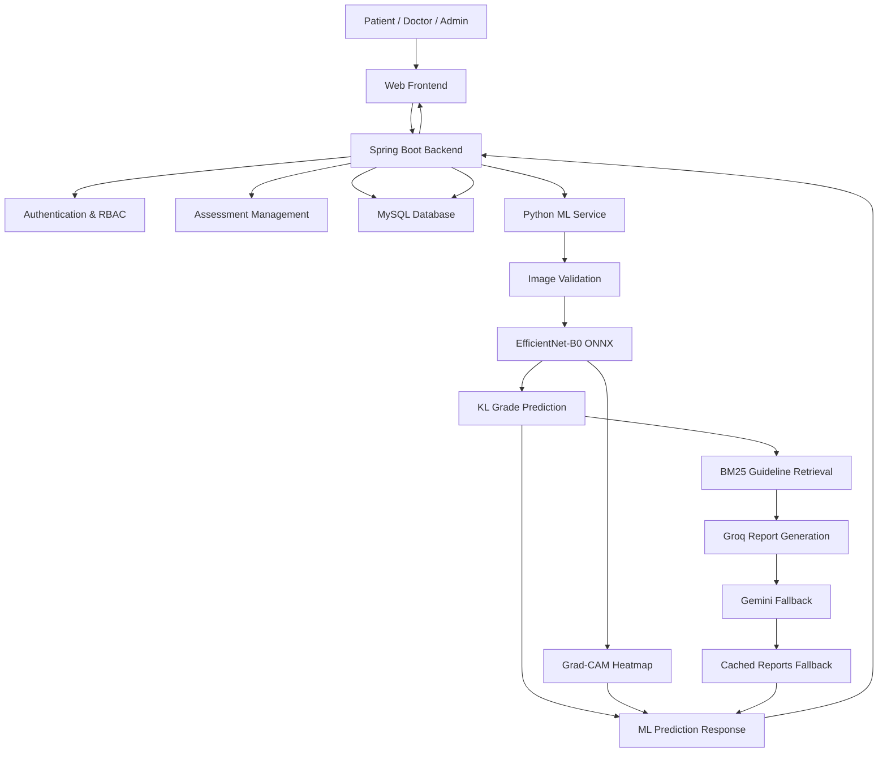

# KneeSense – AI-Based Knee Osteoarthritis Severity Grading

> An AI-powered system that analyses knee X-rays, predicts osteoarthritis severity using the Kellgren–Lawrence (KL 0–4) scale, and generates explainable, audience-specific assessment reports.


---

## 📊 Key Result Snapshot

| Component | Implementation |
|---|---|
| Deep Learning Architecture | EfficientNet-B0 |
| Classification Approach | CORAL Ordinal Classification |
| Classification Scale | Kellgren–Lawrence Grade 0–4 |
| Explainability | Grad-CAM |
| Model Format | ONNX |
| Model Evaluation Accuracy | 63.0% |
| Quadratic Weighted Kappa | 0.820 |
| Mean Absolute Error | 0.432 grades |
| Report Generation | Groq + Gemini fallback |
| Guideline Retrieval | BM25 |
| Backend | Spring Boot |
| Database | MySQL 8.4 |

**In one sentence:** KneeSense combines ordinal deep learning, visual explainability, guideline-based retrieval, and dual-audience report generation in an integrated web application for knee osteoarthritis assessment.

---

## Table of Contents

- [Overview](#overview)
- [Problem Statement](#problem-statement)
- [Project Objectives](#project-objectives)
- [Key Features](#key-features)
- [System Architecture](#system-architecture)
- [Tools & Technologies](#tools--technologies)
- [Dataset & Model](#dataset--model)
- [Project Structure](#project-structure)
- [Methodology & Workflow](#methodology--workflow)
- [Results & Evaluation](#results--evaluation)
- [Security & Privacy](#security--privacy)
- [How to Run This Project](#how-to-run-this-project)
- [API Overview](#api-overview)
- [Limitations & Future Work](#limitations--future-work)
- [Team & Contributions](#team--contributions)
- [Disclaimer](#disclaimer)

---

## Overview

KneeSense is an AI-based knee osteoarthritis assessment application that predicts disease severity from a single knee X-ray.

The system uses a fine-tuned EfficientNet-B0 model with a CORAL ordinal classification head to predict one of five Kellgren–Lawrence (KL) grades, ranging from 0 to 4.

In addition to severity prediction, Grad-CAM provides a visual explanation of the model's focus areas. A Retrieval-Augmented Generation (RAG) pipeline retrieves relevant guideline information and generates two reports: one intended for clinicians and another written in patient-friendly language.

The application integrates a Spring Boot backend, a Python-based machine learning service, and a MySQL database. It supports patient accounts, doctor–patient assignments, assessment history, and role-based access.

## Problem Statement

Knee osteoarthritis is a degenerative joint condition commonly assessed using radiographic imaging. Determining its severity requires examining structural changes such as joint-space narrowing, osteophytes, and changes in bone structure.

Manual interpretation of X-rays can be challenging, and communicating the findings in an understandable way is equally important.

This project addresses the following challenges:

- Automating the classification of knee osteoarthritis severity from X-ray images.
- Preserving the ordinal relationship between the five KL severity grades.
- Providing visual explanations of model predictions.
- Generating separate, understandable reports for clinicians and patients.
- Maintaining secure access to patient assessment records.

## Project Objectives

1. Develop a deep learning model for classifying knee osteoarthritis into KL grades 0–4.
2. Apply ordinal classification to account for the ordered nature of severity grades.
3. Integrate Grad-CAM for visual explanation of model predictions.
4. Implement guideline-based information retrieval for report generation.
5. Generate clinician-oriented and patient-friendly assessment summaries.
6. Develop a secure full-stack application with patient, doctor, and administrator roles.
7. Store assessment metadata and reports while avoiding retention of original X-ray images.

## Key Features

### 1. AI-Based Severity Grading
Predicts knee osteoarthritis severity using an EfficientNet-B0 model with a CORAL ordinal classification head.

### 2. Grad-CAM Explainability
Generates a visual heatmap highlighting image regions that contribute to the model's prediction.

### 3. Dual-Audience Report Generation
Generates two reports:
- **Clinician Report:** Structured summary with guideline-based information.
- **Patient Report:** Simplified explanation in patient-friendly language.

### 4. Guideline-Based RAG
Retrieves relevant guideline snippets using BM25 and supplies them to the report-generation models. Generated reports are checked against retrieved citation IDs.

### 5. Role-Based Access Control
Supports three roles:

| Role | Responsibilities |
|---|---|
| Administrator | User management and doctor–patient assignments |
| Doctor | Access assigned patients and their clinical assessment reports |
| Patient | Upload X-rays and access personal assessment history and patient reports |

### 6. Assessment History
Stores assessment metadata, predicted KL grade, confidence, source, and reports for future reference.

### 7. Account & Data Management
Allows authenticated users to delete their accounts and associated assessment records.

### 8. Privacy-Aware Processing
Original X-ray images and Grad-CAM heatmaps are not retained in assessment history.

---

## System Architecture

KneeSense follows a modular three-tier architecture.



### Architecture Components

| Component | Responsibility |
|---|---|
| Frontend | User interaction, image upload, results and dashboards |
| Spring Boot Backend | Authentication, authorization, API processing and persistence |
| Python ML Service | Image inference, Grad-CAM and report generation |
| ONNX Runtime | Executes the trained deep learning model |
| RAG Pipeline | Retrieves relevant guideline information |
| MySQL | Stores users, assignments, assessment metadata and reports |
| Docker Compose | Integrates and runs the application services |

The browser communicates only with the Java backend. The Java backend communicates with the Python ML service through the internal Docker network using a shared authentication secret.

---

## Tools & Technologies

| Category | Technologies |
|---|---|
| Frontend | HTML5, CSS3, JavaScript |
| Backend | Java 21, Spring Boot 3.5.x |
| Backend Security | Spring Security, JWT, CSRF, BCrypt |
| Database | MySQL 8.4 |
| ORM | Spring Data JPA, Hibernate |
| Deep Learning | PyTorch, EfficientNet-B0, CORAL |
| Model Inference | ONNX, ONNX Runtime |
| Image Processing | OpenCV, NumPy |
| Explainable AI | Grad-CAM |
| Machine Learning API | Python, FastAPI, Uvicorn |
| Retrieval-Augmented Generation | BM25, Groq, Gemini |
| Model Hosting | Hugging Face |
| Containerization | Docker, Docker Compose |
| Testing | JUnit 5, Mockito, Spring Boot Test, Python tests |
| Version Control | Git, GitHub |

---

## Dataset & Model

### Dataset

The model was trained and evaluated using the **Kaggle Knee Osteoarthritis Dataset with Severity Grading**.

The dataset contains knee X-ray images grouped into five KL severity classes.

| Dataset Split | Images |
|---|---|
| Training | 5,778 |
| Validation | 826 |
| Testing | 1,656 |
| **Total** | **8,260** |

### KL Grade Classification

| Grade | Severity | Description |
|---|---|---|
| KL 0 | Normal | No radiographic signs of osteoarthritis |
| KL 1 | Doubtful | Doubtful joint-space narrowing and possible small osteophytes |
| KL 2 | Mild | Definite osteophytes with possible joint-space narrowing |
| KL 3 | Moderate | Multiple osteophytes and definite joint-space narrowing |
| KL 4 | Severe | Large osteophytes, marked joint-space loss and bone changes |

### Model Architecture

**EfficientNet-B0 with CORAL Ordinal Classification**

The model uses EfficientNet-B0 as its feature extraction backbone and a CORAL ordinal head for predicting the ordered severity grades.

Unlike ordinary multi-class classification, ordinal classification accounts for the relationship between consecutive severity levels.

### Model Pipeline

1. Input knee X-ray image.
2. Image preprocessing and contrast enhancement.
3. Feature extraction using EfficientNet-B0.
4. CORAL ordinal prediction.
5. KL grade and confidence calculation.
6. Grad-CAM heatmap generation.
7. ONNX Runtime inference through the Python ML service.

### Image Preprocessing

- Convert image to 8-bit grayscale.
- Apply CLAHE contrast enhancement.
- Convert to three channels.
- Resize to 224 × 224 pixels.
- Normalize using ImageNet mean and standard deviation.

The trained model is exported to ONNX format and downloaded by the ML service from Hugging Face.

For additional model details, see `ml-service/model/model_card.md`.

---

## Project Structure

```text
KneeSense/
│
├── backend-java/
│   ├── db/
│   │   └── schema.sql
│   │
│   ├── src/
│   │   ├── main/
│   │   │   ├── java/com/kneesense/
│   │   │   │   ├── api/
│   │   │   │   │   ├── admin/
│   │   │   │   │   ├── assessment/
│   │   │   │   │   ├── auth/
│   │   │   │   │   └── doctor/
│   │   │   │   ├── bootstrap/
│   │   │   │   ├── config/
│   │   │   │   ├── domain/
│   │   │   │   ├── ml/
│   │   │   │   ├── repository/
│   │   │   │   └── security/
│   │   │   │
│   │   │   └── resources/
│   │   │       ├── application.properties
│   │   │       └── static/
│   │   │           └── index.html
│   │   │
│   │   └── test/
│   │       └── java/com/kneesense/
│   │
│   ├── Dockerfile
│   ├── .dockerignore
│   ├── pom.xml
│   └── README.md
│
├── ml-service/
│   ├── model/
│   │   ├── train.py
│   │   ├── dataset.py
│   │   ├── evaluate.py
│   │   ├── inference.py
│   │   ├── gradcam.py
│   │   ├── export_onnx.py
│   │   └── model_card.md
│   │
│   ├── rag/
│   │   ├── guidelines/
│   │   ├── build_index.py
│   │   ├── retriever.py
│   │   ├── report_generator.py
│   │   └── make_cache.py
│   │
│   ├── cache/
│   │   └── cached_reports.json
│   │
│   ├── tests/
│   │
│   ├── app.py
│   ├── requirements.txt
│   ├── Dockerfile
│   ├── .dockerignore
│   ├── .env.example
│   └── README.md
│
├── docs/
│   ├── api_contract.md
│   └── known-limitations.md
│
├── scripts/
│   └── download_dataset.sh
│
├── docker-compose.yml
├── .env.example
├── .gitignore
└── README.md
```

> **Note:** Dataset files, trained model weights, generated BM25 indexes, environment files, and other local artifacts are excluded from version control.

---

## Methodology & Workflow

The complete KneeSense workflow consists of the following stages.

### Stage 1 – Image Upload & Validation

- Patient selects a knee X-ray image.
- PNG and JPEG formats are accepted.
- Image size is restricted to 5 MiB.
- The backend validates the image using its actual file signature.
- Image bytes are processed without retaining the original image file.

### Stage 2 – Deep Learning Inference

- Java forwards the validated image to the Python ML service.
- Python loads the EfficientNet-B0 ONNX model.
- The model predicts the KL severity grade.
- The model calculates an uncalibrated confidence score.

### Stage 3 – Explainability

Grad-CAM generates a heatmap representing image regions contributing to the model output.

The heatmap is returned to the frontend in the immediate assessment response and is not stored in historical records.

### Stage 4 – Guideline Retrieval

- The predicted KL grade determines the relevant guideline category.
- BM25 retrieves the top relevant guideline snippets.
- Retrieved snippets are supplied to the report-generation pipeline.

### Stage 5 – Report Generation

The report-generation pipeline follows this sequence:

1. Groq is attempted first.
2. Gemini is attempted if Groq fails.
3. Generated responses are checked for valid retrieved-snippet citations.
4. Cached reports are used if live report generation fails.

Two reports are generated:

- Clinician-oriented report.
- Patient-friendly report.

Both reports include the project disclaimer.

### Stage 6 – Database Persistence

After successful prediction:

- Upload metadata and SHA-256 content hash are stored.
- Predicted grade and confidence are stored.
- Clinician and patient reports are stored.
- Original X-ray bytes and heatmap images are not persisted.

### Stage 7 – Result Presentation

The patient receives the predicted grade, confidence score, Grad-CAM visualisation and patient-friendly report.

Assigned doctors can access the relevant clinical reports through the doctor portal.

---

## Results & Evaluation

The trained model was evaluated on a held-out test set of 1,656 images.

### Overall Performance

| Evaluation Metric | Result |
|---|---|
| Accuracy | 63.0% |
| Macro F1-Score | 0.587 |
| Quadratic Weighted Kappa (QWK) | 0.820 |
| Mean Absolute Error (MAE) | 0.432 grades |
| Predictions within ±1 grade | 94.1% |
| Mean Confidence | 0.508 |

### Selected Class-Level Results

| KL Grade | Sensitivity | Specificity |
|---|---|---|
| Grade 1 – Doubtful | 29.7% | 87.5% |
| Grade 2 – Mild | 47.2% | 92.3% |

### Interpretation

- The Quadratic Weighted Kappa of 0.820 indicates strong ordinal agreement on this test set.
- 94.1% of predictions were within one severity grade of the reference label.
- Grade 1 remains the weakest-performing class, with a sensitivity of approximately 30%.
- The average confidence score is uncalibrated and must not be interpreted as the probability that a prediction is correct.

> These results are from the model evaluation. They do not establish clinical validity or real-world diagnostic performance.

Refer to `model_card.md` for detailed evaluation information.

---

## Security & Privacy

Security and data protection are incorporated into the application architecture.

| Area | Implementation |
|---|---|
| Authentication | JWT stored in an HttpOnly cookie |
| Password Security | BCrypt password hashing |
| Authorization | Role-Based Access Control |
| CSRF Protection | CSRF token cookie and request header |
| Image Validation | PNG/JPEG signature validation |
| Upload Restriction | Maximum 5 MiB |
| Session Management | Secure logout and cookie expiration |
| Account Deletion | Cascading deletion of user-associated records |
| Internal Service Security | Shared-secret authentication between Java and Python |
| Database Access | Patient ownership and doctor assignment checks |

### Data Privacy

- Original X-ray images are not retained as uploaded image files.
- Only approved assessment metadata and a SHA-256 content hash are stored.
- Grad-CAM heatmaps are not retained in historical records.
- Patients cannot access clinician-only report content.
- Doctors can access only assigned patients.
- Account deletion removes associated assignments and assessment records.

### Rate Limiting

| Operation | Current Limit |
|---|---|
| Login attempts | 5 per minute per IP |
| Per-user live reports | 10 per 24 hours |
| Global live reports | 200 per rolling 24 hours |

The current rate limiters use in-memory state. They are not distributed across multiple application instances.

---

## How to Run This Project

### Prerequisites

- Docker Desktop with Docker Compose.
- Git.
- Internet connection for downloading dependencies and the ONNX model.
- Groq or Gemini API credentials for live report generation.

### Step 1 – Clone the Repository

```bash
git clone <repository-url>
cd KneeSense
```

### Step 2 – Configure Environment Variables

For the Java backend and MySQL:

```powershell
Copy-Item .env.example .env.kneesense
```

For the Python ML service:

```powershell
Copy-Item .\ml-service\.env.example .\ml-service\.env
```

Configure the required database credentials, JWT secret, ML-service shared secret and AI provider credentials.

> **Important:** The `ML_SERVICE_SECRET` in `.env.kneesense` must exactly match `INTERNAL_AUTH_SECRET` in `ml-service/.env`.

Keep both local environment files out of Git.

### Step 3 – Create the Database Volume

```bash
docker volume create kneesense-mysql-data
```

### Step 4 – Build and Start the Services

```bash
docker compose --env-file .env.kneesense up -d --build
```

Docker Compose starts:

- MySQL database – port `3307`
- Python ML service – port `8000`
- Java Spring Boot backend – port `8080`

All ports are bound to localhost.

### Step 5 – Verify Service Health

Backend:

```powershell
Invoke-RestMethod http://localhost:8080/api/health
```

ML service:

```powershell
Invoke-RestMethod http://localhost:8000/health
```

### Step 6 – Access the Application

Open: **http://localhost:8080/**

### Step 7 – View Container Logs

```bash
docker compose --env-file .env.kneesense logs -f
```

### Step 8 – Stop the Application

```bash
docker compose --env-file .env.kneesense down
```

The external MySQL volume remains intact when containers are stopped.

> **Warning:** Do not use `docker compose down -v`, as the database volume contains persistent application data.

---

## API Overview

Spring Boot exposes the application APIs. The browser does not communicate directly with the Python ML service.

### Authentication APIs

| Method | Endpoint | Description |
|---|---|---|
| GET | `/api/auth/csrf` | Retrieve CSRF token information |
| POST | `/api/auth/signup` | Register a patient |
| POST | `/api/auth/login` | Authenticate user |
| POST | `/api/auth/logout` | Sign out |
| GET | `/api/me` | Retrieve current user |
| DELETE | `/api/me` | Delete current account |

### Assessment APIs

| Method | Endpoint | Description |
|---|---|---|
| POST | `/api/assessments` | Upload X-ray and create assessment |
| GET | `/api/assessments` | Retrieve patient assessment history |
| GET | `/api/assessments/{resultId}` | Retrieve assessment details |

### Doctor APIs

| Method | Endpoint | Description |
|---|---|---|
| GET | `/api/doctor/patients` | List assigned patients |
| GET | `/api/doctor/patients/{patientId}/assessments` | View patient assessment history |
| GET | `/api/doctor/patients/{patientId}/assessments/{resultId}` | View assessment and clinician report |

### Administrator APIs

| Method | Endpoint | Description |
|---|---|---|
| GET | `/api/admin/users` | List users |
| PUT | `/api/admin/users/{id}/role` | Update user role |
| GET | `/api/admin/assignments` | View doctor–patient assignments |
| POST | `/api/admin/assignments` | Create an assignment |
| DELETE | `/api/admin/assignments/{doctorId}/{patientId}` | Remove an assignment |

For the detailed Java–Python integration contract, request fields, response fields, and error handling, refer to `docs/api_contract.md`.

---

## Limitations & Future Work

### Current Limitations

1. The model has not been clinically validated.
2. Performance on external hospital datasets and different scanner types is unknown.
3. KL Grade 1 has relatively low sensitivity.
4. Model confidence is uncalibrated.
5. Grad-CAM is a coarse explanation aid rather than precise localisation.
6. Rate limits are process-local and reset when services restart.
7. Java's per-user forced-cache header is not yet handled by the current Python prediction endpoint.

### Future Work

- Complete and test the per-user cached-report fallback integration.
- Improve model generalisation using more diverse X-ray datasets.
- Investigate confidence calibration and class-wise performance improvements.
- Expand model validation on external datasets.
- Add distributed rate limiting and production monitoring.
- Implement automated integration testing and CI/CD.
- Deploy the application to a production environment.

---

## Team & Contributions

| Team Member | Role | Contribution |
|---|---|---|
| Tejaswi Pise | AI / Deep Learning Lead | CNN architecture, model training, evaluation, ONNX export and inference integration |
| T. Lahari | NLP / GenAI Lead | Guideline retrieval, RAG pipeline, report generation, provider integration and cached reports |
| M. Jyothi Krishna | Full-Stack & Integration Lead | Spring Boot backend, authentication, RBAC, MySQL persistence, frontend integration, Docker Compose and system integration |

---

## Disclaimer

KneeSense is an academic research and educational project.

It is not a medical device, is not clinically validated, and is not intended to diagnose, treat, or prevent any medical condition.

AI-generated grades, heatmaps, confidence scores and reports are informational outputs only. They must not be used as substitutes for professional medical evaluation.

Always consult a qualified healthcare professional for medical interpretation and treatment decisions.